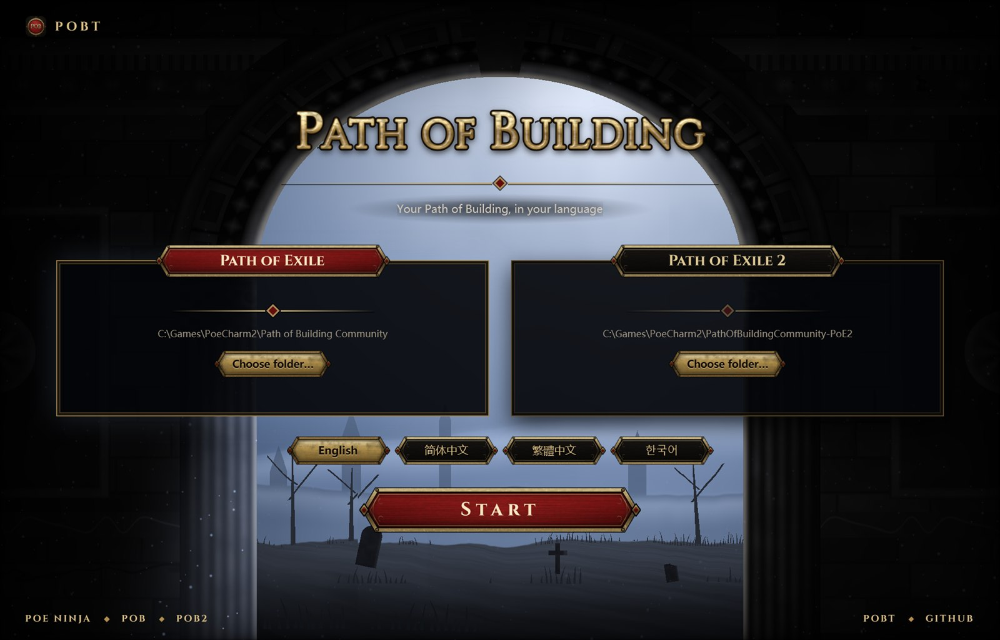

<p align="center"></p>

<h1 align="center">POBT</h1>

<p align="center">
  <b>Path of Building, in your language.</b><br>
  English | <a href="README.zh-CN.md">简体中文</a> · <a href="https://huacnlee.github.io/pobt/">Website</a>
</p>

<p align="center"></p>

POBT runs the [Path of Building Community](https://pathofbuilding.community/) you already have — for Path of Exile
and Path of Exile 2 — with its whole interface translated: skills, items, passives and calculations. Simplified
Chinese, Traditional Chinese and Korean are included.

- Your Path of Building files are never modified; your builds stay where they are.
- Press **Ctrl+Shift+T** at any time to switch to English and back.
- POBT updates itself when a new version is out.

## Download

**[Download POBT for Windows (.zip)](https://github.com/huacnlee/pobt/releases/latest/download/pobt-windows-x86_64.zip)**

1. Unpack the zip anywhere (right-click → Extract All).
2. Run `POBT.exe`. Windows may warn about a new program: choose **More info**, then **Run anyway**.
3. POBT finds Path of Building on its own; if it does not, choose its folder.
4. Pick the game and the language, then **Start**.

Or install it with PowerShell, which adds Start menu and desktop shortcuts and updates POBT when run again:

```powershell
irm https://huacnlee.github.io/pobt/install.ps1 | iex
```

## Requirements

- 64-bit Windows 10 or 11
- [Path of Building Community](https://pathofbuilding.community/) for Path of Exile 1, 2 or both

## Questions

**Path of Building updated — does POBT keep up?** Yes: POBT runs the Path of Building you have installed, so update
Path of Building as usual.

**A translation is wrong or missing.** Translations are CSV files in [`trs/`](trs); issues and pull requests are
welcome. See [CONTRIBUTING.md](CONTRIBUTING.md).

## Credits

- [Path of Building Community](https://github.com/PathOfBuildingCommunity/PathOfBuilding), the planner POBT runs.
- [PoeCharm2](https://github.com/Chuanhsing/PoeCharm2), whose contributors wrote the translations ([`trs/SOURCE.md`](trs/SOURCE.md)).
- [Native Shell](https://nsh.dev), the framework POBT is built with.

Path of Exile is a trademark of Grinding Gear Games. POBT is not affiliated with Grinding Gear Games or the Path of
Building Community. POBT is licensed under the [Apache License 2.0](LICENSE).
