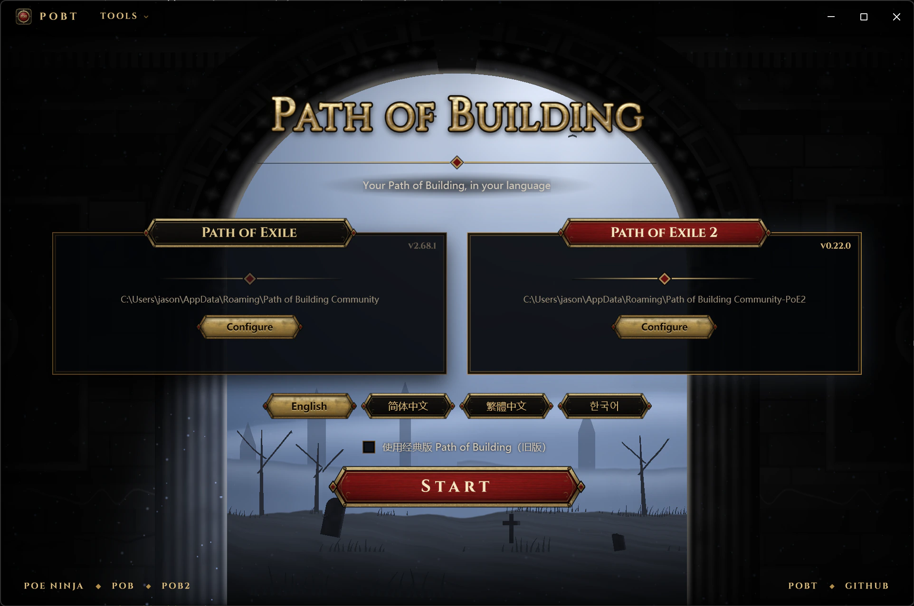
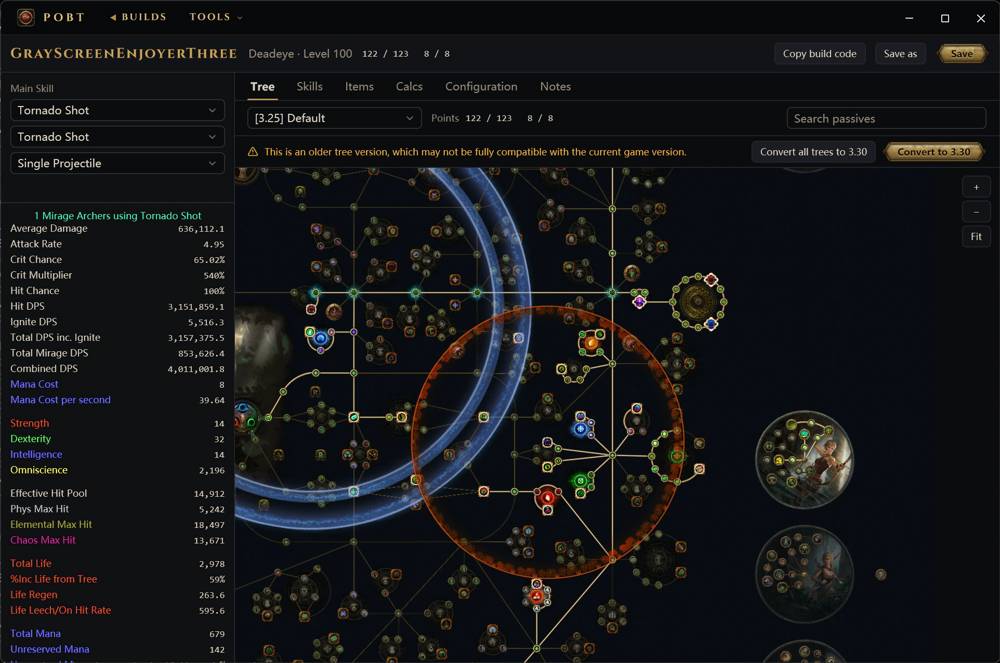
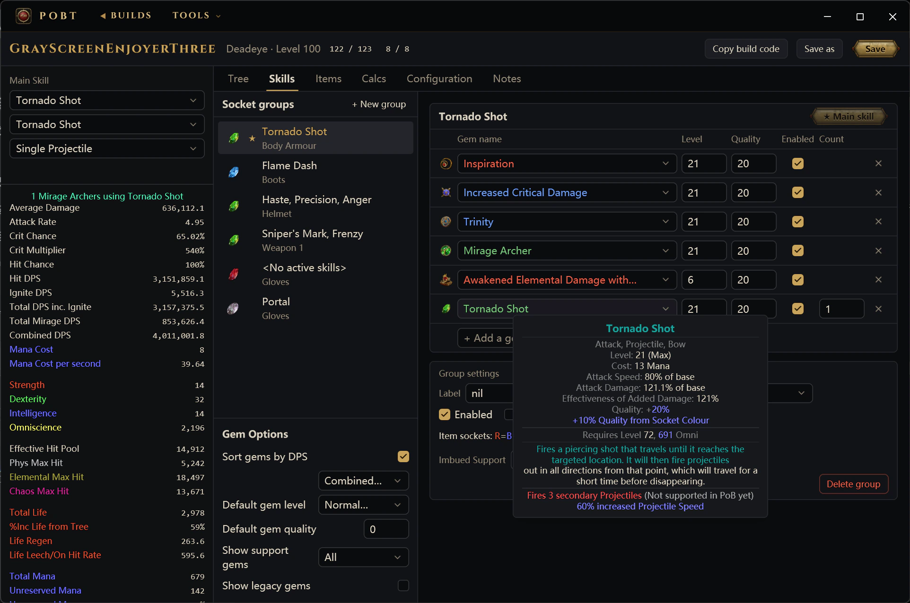
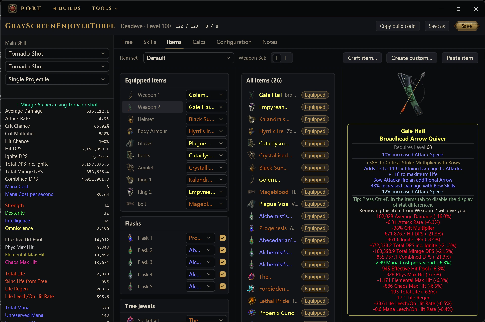
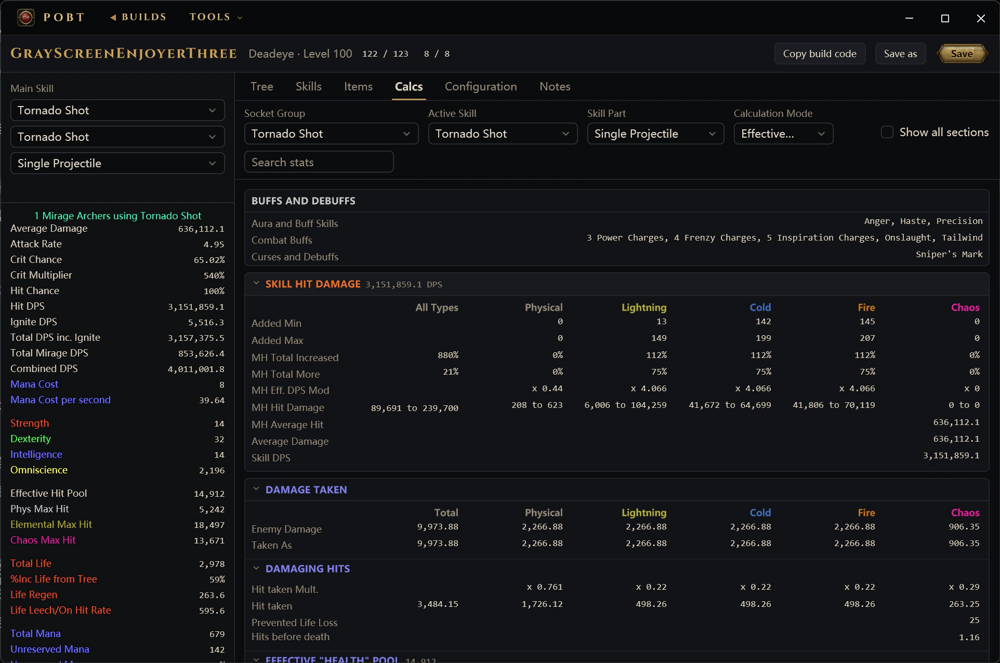
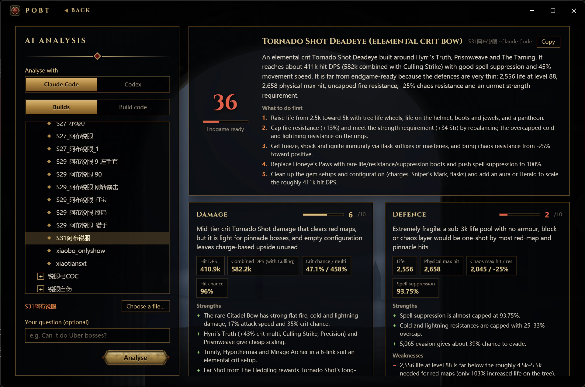

<p align="center"></p>

<h1 align="center">POBT</h1>

<p align="center">
  <b>Path of Building, in your language.</b><br>
  English | <a href="README.zh-CN.md">简体中文</a> · <a href="https://huacnlee.github.io/pobt/">Website</a>
</p>

<p align="center"></p>

<p align="center">
  
  
  
  
</p>

POBT runs the [Path of Building Community](https://pathofbuilding.community/) you already have — for Path of Exile
and Path of Exile 2 — with its whole interface translated: skills, items, passives and calculations. Simplified
Chinese, Traditional Chinese and Korean are included.

- Your Path of Building files are never modified; your builds stay where they are.
- Press **Ctrl+Shift+T** at any time to switch to English and back.
- The translations are plain CSV files in the `trs` folder beside `POBT.exe`: edit them to fix one or add your own (an update of POBT replaces the folder, so keep a copy of your changes).
- POBT updates itself when a new version is out.
- **Import characters** from an account, as a build code or a build saved in Path of Building: see below.
- **AI build analysis**: from the Tools menu, choose one of your builds (or paste a build code) and have the AI already on your computer, Claude Code or Codex, rate it by damage, defence, recovery, ailments, utility and gear, with what to change first. POBT sends it no account and keeps no key: the agent runs as you signed it in.

<p align="center"></p>

## Import characters

Open **Tools → Import characters** on the launcher (or over Path of Building), list an account's characters, and copy
a character's build code or save it among Path of Building's builds.

- **Path of Exile**: the official site's realms (PC, Xbox, PlayStation): the account name, and its POESESSID for a
  private profile. Tencent's realm: its POESESSID. Tencent's Chinese items go back to English first.
- **Path of Exile 2**: the official site's characters once signed in to pathofexile.com in the browser, as Path of
  Building 2 does. Tencent's, by a WeGame share link: in WeGame's Path of Exile 2 helper, open the character's data and
  press Share (一键分享).

## The build editor

POBT opens on its own build screens: the passive tree, skills, items, calculations,
configuration and notes, in a new interface, translated. The numbers are Path of Building's own: the Path of Building
you have installed runs with no window behind the screens and does every calculation, so it stays exact and follows
each update of Path of Building. Its first screen lists Path of Building's builds folder; saving writes the same file,
so both see every build. The classic Path of Building, in its own window, stays under **Tools → Classic Path of
Building (legacy)**.

## Performance

POBT can stand in for Path of Building's own program: it runs Path of Building's code with its own program in place
of `Path of Building.exe` and its graphics runtime. Measured on the same PC with the same build open on the passive
tree:

| | POBT 0.2.0 | Path of Building 2.68.1 |
| --- | ---: | ---: |
| Start to the build on screen | **2.70 s** | 3.38 s |
| Start to the build list | **1.51 s** | 1.87 s |
| CPU while idle | **8.0% of a core** | 46.4% of a core |
| Private memory | **893 MB** | 1,011 MB |
| Peak private memory while loading | **1,007 MB** | 1,507 MB |
| Working set | 725 MB | **517 MB** |
| Native files to run it | 50 MB (20 MB zipped) | **28 MB** (11 MB zipped) |

How it was measured:

- **Version**: the official POBT 0.2.0 release download.
- **Runs**: medians of 5 warm runs.
- **Machine**: i7-13700KF, 32 GB of memory, RTX 3060 Ti, Windows 11.
- **Windows**: both windows were 1600×1000 and in front.
- **POBT**: showing Chinese.
- **Startup**: ends when the screen shows Path of Building. For POBT it adds the time to its launcher and the time
  from **Start** to Path of Building on screen.
- **CPU and memory**: taken over 30 s once the build was open and loading had settled. CPU is the process's average
  over those 30 s.
- **Native files**: everything native each needs to run. For Path of Building: its exe, all its DLLs (graphics,
  C++ runtime, Lua and its modules) and `SimpleGraphic` with its fonts. For POBT: its program and the 5 Lua DLLs of
  Path of Building it loads. The Lua code and data both use, and POBT's translations, are not counted.
- **Working set**: POBT keeps the passive tree's images in memory where Path of Building keeps them in video memory
  (POBT uses half the video memory), and the translations take about 45 MB. Most of it is idle: trimmed, both take
  back about 70 MB.

## Download

**[Download POBT for Windows (.zip)](https://github.com/huacnlee/pobt/releases/latest/download/pobt-windows-x86_64.zip)**

1. Unpack the zip anywhere (right-click → Extract All).
2. Run `POBT.exe`. Windows may warn about a new program: choose **More info**, then **Run anyway**.
3. POBT finds Path of Building on its own; if it does not, choose its folder, or press **Install** to download it from its GitHub release.
4. Pick the game and the language, then **Start**.

Or install it with PowerShell, which adds Start menu and desktop shortcuts and updates POBT when run again:

```powershell
irm https://huacnlee.github.io/pobt/install.ps1 | iex
```

On macOS (Apple silicon) or Linux (x86_64, arm64), install or update it with:

```bash
curl -fsSL https://huacnlee.github.io/pobt/install.sh | bash
```

It verifies the checksum, puts `POBT.app` in Applications on macOS, and on Linux installs to `~/.local/share/pobt` with a `pobt` command and an app launcher entry.

## Requirements

- 64-bit Windows 10 or 11
- [Path of Building Community](https://pathofbuilding.community/) for Path of Exile 1, 2 or both

## Questions

**Path of Building updated — does POBT keep up?** Yes: POBT runs the Path of Building you have installed, so update
Path of Building as usual.

**A translation is wrong or missing.** Translations are CSV files in [`trs/`](trs); issues and pull requests are
welcome. See [CONTRIBUTING.md](CONTRIBUTING.md).

## Credits

- [Path of Building Community](https://github.com/PathOfBuildingCommunity/PathOfBuilding), the planner POBT runs.
- [PoeCharm2](https://github.com/Chuanhsing/PoeCharm2), whose contributors wrote the translations ([`trs/SOURCE.md`](trs/SOURCE.md)).
- [Native Shell](https://nsh.dev), the framework POBT is built with.

Path of Exile is a trademark of Grinding Gear Games. POBT is not affiliated with Grinding Gear Games or the Path of
Building Community. POBT is licensed under the [Apache License 2.0](LICENSE).
