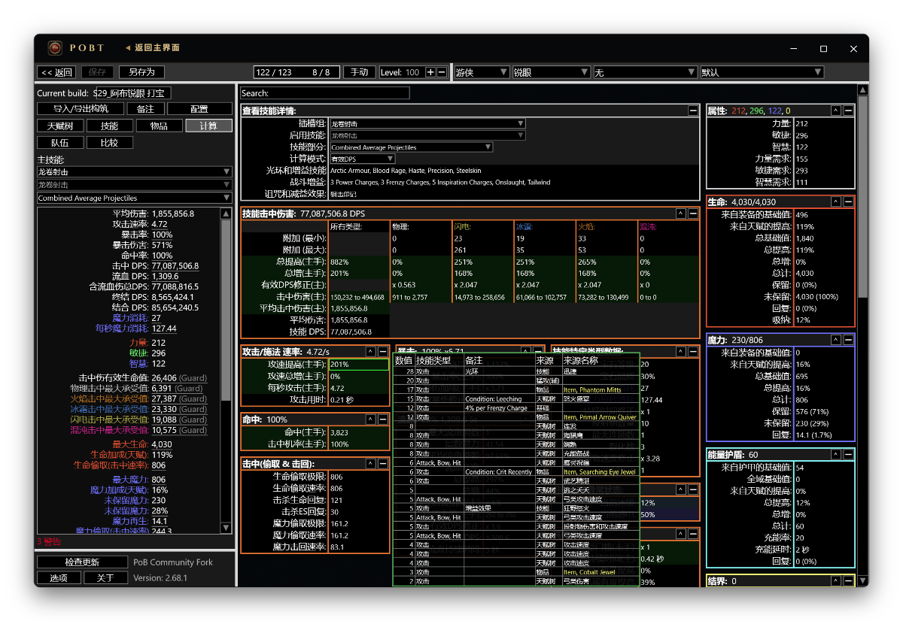

<p align="center"></p>

<h1 align="center">POBT</h1>

<p align="center">
  <b>POB 构筑的多语言翻译</b><br>
  <a href="README.md">English</a> | 简体中文 · <a href="https://huacnlee.github.io/pobt/zh-CN/">官网</a>
</p>

<p align="center"></p>

<p align="center">
  
  
  
</p>

POBT 直接运行你电脑上已有的 [Path of Building Community](https://pathofbuilding.community/)（流放之路 1 和 2），
并把整个界面翻译成中文：技能、物品、天赋、计算结果，一应俱全。支持简体中文、繁體中文和한국어。

- 不修改任何 Path of Building 文件，你的 BD 仍在原来的位置。
- 随时按 **Ctrl+Shift+T** 切换中文 / 英文。
- 翻译是 `POBT.exe` 旁边 `trs` 文件夹里的 CSV 文件，可以自己修改或补充（POBT 更新时会覆盖这个文件夹，改过的内容请自己备份）。
- 有新版本时自动更新。

## 性能

POBT 可以代替 Path of Building 自带的程序使用：它运行的是 Path of Building 自己的代码，只是用 POBT 自己的程序代替了
`Path of Building.exe` 和它的图形运行时。在同一台电脑上，打开同一个 BD、停在天赋树页实测：

| | POBT 0.2.0 | Path of Building 2.68.1 |
| --- | ---: | ---: |
| 启动到看到 BD | **2.71 秒** | 3.33 秒 |
| 启动到看到 BD 列表 | **1.65 秒** | 2.06 秒 |
| 空闲时 CPU | **单核的 8.8%** | 单核的 47.3% |
| 私有内存 | **895 MB** | 1,022 MB |
| 加载 BD 时的私有内存峰值 | **1,016 MB** | 1,510 MB |
| 工作集内存 | 724 MB | **514 MB** |
| 程序体积 | 48 MB（压缩包 19 MB） | 原生程序文件 **20 MB** |

测量方法：

- **次数**：多次热启动取中位数（每项 3 到 4 次）。
- **测试机**：i7-13700KF、32 GB 内存、RTX 3060 Ti、Windows 11。
- **窗口**：两个窗口都是 1600×1000，且都在前台。
- **POBT**：显示中文。
- **启动时间**：以屏幕上出现 Path of Building 界面为终点。POBT 的时间等于打开启动器的时间，加上点击「启动」到出现
  Path of Building 界面的时间。
- **CPU 和内存**：在 BD 打开、加载平稳后测 30 秒，CPU 取这 30 秒的平均占用。
- **程序体积**：POBT 解压后的程序（不含翻译文件），对比它所替代的 Path of Building 原生程序文件：
  `Path of Building.exe`、`SimpleGraphic.dll` 及其依赖的 DLL。

## 下载

**[下载 POBT Windows 版（zip）](https://github.com/huacnlee/pobt/releases/latest/download/pobt-windows-x86_64.zip)**

1. 把压缩包解压到任意位置（右键 → 全部解压缩）。
2. 运行 `POBT.exe`。Windows 提示新程序时，点 **更多信息**，再点 **仍要运行**。
3. POBT 会自动找到 Path of Building；找不到时手动选择它的文件夹，或点「安装」从 GitHub 下载最新版。
4. 选好游戏和语言，点 **启动**。

也可以用 PowerShell 安装（会创建开始菜单和桌面快捷方式，再次运行即可更新）：

```powershell
irm https://huacnlee.github.io/pobt/install.ps1 | iex
```

## 运行需要

- 64 位 Windows 10 或 11
- 已安装 [Path of Building Community](https://pathofbuilding.community/)（流放之路 1、2 任一或全部）

## 常见问题

**Path of Building 更新了，POBT 跟得上吗？** 跟得上：POBT 运行的就是你安装的 Path of Building，照常更新即可。

**发现翻译错误或缺失？** 翻译是 [`trs/`](trs) 下的 CSV 文件，欢迎提 Issue 或 Pull Request，参见
[CONTRIBUTING.md](CONTRIBUTING.md)。

## 致谢

- [Path of Building Community](https://github.com/PathOfBuildingCommunity/PathOfBuilding)：POBT 运行的构筑工具。
- [PoeCharm2](https://github.com/Chuanhsing/PoeCharm2)：翻译数据由其贡献者整理（[`trs/SOURCE.md`](trs/SOURCE.md)）。
- [Native Shell](https://nsh.dev)：POBT 使用的框架。

Path of Exile（流放之路）是 Grinding Gear Games 的商标。POBT 与 Grinding Gear Games 及 Path of Building Community
无关。POBT 以 [Apache License 2.0](LICENSE) 开源。
